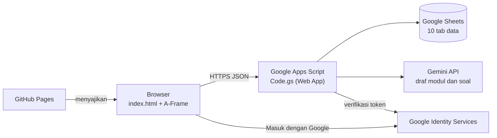

# Kelas Raudhah

**Kelas virtual 3D di browser untuk belajar Math, Science, Bahasa, Agama, dan Seni, lengkap dengan penilaian otomatis, poin, pemantauan guru, dan pembuat soal berbantuan AI.**

> **RAUDHAH** = **R**uang **E**dukasi dan **D**igital **M**adrasah


-8ecae6)


**Demo:** https://diahayu88.github.io/kelas_raudhah/

---

## Daftar Isi

1. [Tentang](#tentang)
2. [Fitur](#fitur)
3. [Arsitektur](#arsitektur)
4. [Struktur Repositori](#struktur-repositori)
5. [Pemasangan](#pemasangan)
6. [Konfigurasi](#konfigurasi)
7. [Peran dan Hak Akses](#peran-dan-hak-akses)
8. [Keamanan](#keamanan)
9. [Privasi Data](#privasi-data)
10. [Alur Pembaruan](#alur-pembaruan)
11. [Pemecahan Masalah](#pemecahan-masalah)
12. [Peta Jalan](#peta-jalan)
13. [Kontribusi](#kontribusi)
14. [Lisensi](#lisensi)
15. [Kontak](#kontak)

---

## Tentang

**RAUDHAH** adalah akronim dari **Ruang Edukasi dan Digital Madrasah**: ruang belajar digital milik madrasah yang menyatukan materi, latihan, penilaian, dan pemantauan dalam satu tempat.

<!-- GAMBAR README 1: banner proyek (logo Kelas Raudhah + ruang kelas 3D), simpan di docs/banner.png lalu ganti baris ini dengan  -->

Kelas Raudhah memindahkan pengalaman duduk di kelas ke layar. Siswa berjalan di ruang kelas 3D, memilih meja mata pelajaran, membaca modul, mengerjakan 10 soal latihan, dan mengumpulkan poin. Guru membuat kelas, memantau progres, dan menyiapkan paket soal dengan bantuan AI yang selalu melalui persetujuan guru sebelum terlihat siswa.

Tujuan: meningkatkan motivasi belajar siswa MTs/SMP dengan media yang menarik, tanpa instalasi, tanpa biaya server, dan dengan data yang tetap berada di tangan pengelola.

Dikelola oleh pengelola Kelas Raudhah di MTsN 7 Kediri sebagai prototipe pembelajaran.

## Fitur

**Untuk siswa**
- Ruang kelas 3D dengan tujuh meja (Math, Science, Bahasa, Agama, Seni), dapat dibuka di ponsel dan komputer.
- Kontrol: geser/WASD/joystick untuk berjalan dan melihat, klik meja untuk duduk, tombol Berdiri.
- Masuk dengan akun Google, atau daftar dengan email dan sandi memakai kode kelas.
- Modul bacaan dan latihan 10 soal pilihan ganda yang tampil satu per satu, dengan penjelasan jawaban.
- Poin (10 per soal, hanya dari jawaban pertama) dan bintang (bawaan 100 poin = 1 bintang).
- Soal dan pilihan jawaban diacak berbeda untuk tiap siswa.
- Aturan ketuntasan: selesaikan latihan yang sedang berjalan sebelum pindah mapel.
- Mode terang dan gelap otomatis.

**Untuk guru**
- Membuat kelas dan kode kelas; membuat akun siswa.
- Memantau progres siswa pada kelas sendiri.
- Pembuat paket soal dengan AI (modul 150-300 kata + soal LOTS/MOTS/HOTS) berstatus draf.
- Impor soal manual, sunting draf, setujui, tolak, dan tarik paket.

**Untuk pemilik (pengelola)**
- Menambah guru, melihat semua kelas dan draf, mengatur batas harian pemakaian AI.
- Seluruh data terbuka di Google Sheets, termasuk log audit.

### Tampilan

Simpan gambar di folder `docs/`, lalu ganti setiap komentar dengan baris gambar. Tutup email, nama siswa, alamat `/exec`, dan Client ID pada tangkapan layar.

<!-- GAMBAR README 2: ruang kelas 3D tampak keseluruhan ->  -->
<!-- GAMBAR README 3: layar masuk dan pendaftaran ->  -->
<!-- GAMBAR README 4: modul dan soal satu per satu ->  -->
<!-- GAMBAR README 5: progres siswa dan panel guru ->  -->
<!-- GAMBAR README 6: pembuat paket soal AI dan editor draf ->  -->

## Arsitektur



| Komponen | Teknologi | Peran |
|---|---|---|
| Antarmuka | HTML, JavaScript, A-Frame 1.5.0 | ruang 3D, panel materi dan soal, panel guru |
| Server | Google Apps Script (`Code.gs`) | login, hak akses, penilaian, progres, pembuat draf |
| Basis data | Google Sheets | pengguna, kelas, materi, soal, poin, log |
| Login | Google Identity Services | masuk dengan akun Google |
| AI | Gemini API (via server) | menyusun draf modul dan soal |
| Hosting | GitHub Pages | menyajikan halaman statis |

**Data (10 tab):** Pengaturan, Kelas, Pengguna, Mapel, Materi, Soal, Progres, Poin, Bintang, Log.

## Struktur Repositori

```
kelas_raudhah/
├── index.html    # aplikasi: antarmuka 3D dan logika klien
├── privasi.html  # kebijakan privasi
├── syarat.html   # ketentuan layanan
└── README.md     # dokumen ini
```

`Code.gs` dipasang di editor Apps Script yang terikat ke Google Sheets, bukan di repositori ini.

## Pemasangan

### Prasyarat

- Akun GitHub dan akun Google.
- Proyek di Google Cloud Console (untuk OAuth Client ID).
- Kunci API Gemini dari Google AI Studio (hanya untuk fitur AI).

### 1. Repositori dan GitHub Pages

1. Buat repositori publik `kelas_raudhah`, unggah semua berkas ke cabang `main`.
2. Settings > Pages > Source: *Deploy from a branch* > `main` / `(root)`.
3. Alamat aplikasi: `https://<akun>.github.io/kelas_raudhah/`.

### 2. Google Sheets dan Apps Script

1. Buat Google Sheets baru, lalu Ekstensi > Apps Script.
2. Tempel isi `Code.gs`, simpan.
3. Isi Script Properties (lihat [Konfigurasi](#konfigurasi)).
4. Jalankan fungsi `siapkanSheet` sekali: membuat 10 tab dan isi awal (aman diulang).
5. Jalankan `cekPemilik` untuk memastikan email pemilik terbaca.
6. Deploy > Deployment baru > Aplikasi Web > Jalankan sebagai: *Saya* > Akses: *Siapa saja*.
7. Salin alamat berakhiran `/exec`.

### 3. Login Google

1. Google Cloud Console > OAuth consent screen: isi nama aplikasi, tautan `privasi.html` dan `syarat.html`.
2. Credentials > OAuth client ID > *Web application*.
3. Authorized JavaScript origins: `https://<akun>.github.io`.
4. Salin Client ID.

### 4. Hubungkan halaman ke server

Pada awal skrip `index.html`, isi dua konstanta:

```js
var API_URL = 'https://script.google.com/macros/s/<ID-DEPLOYMENT>/exec';
var GOOGLE_CLIENT_ID = '<id-klien>.apps.googleusercontent.com';
```

Commit perubahan. Label versi di pojok kiri bawah halaman harus menampilkan versi yang sama dengan server; bila tidak, label berubah merah.

### Daftar periksa

- [ ] GitHub Pages aktif
- [ ] `siapkanSheet` sukses (10 tab)
- [ ] Client ID di halaman sama dengan di Script Properties
- [ ] Origin Google memuat alamat GitHub Pages
- [ ] `API_URL` berisi alamat `/exec` terbaru
- [ ] `VERSI` halaman sama dengan `VERSI` server

## Konfigurasi

### Script Properties (rahasia, tidak masuk Git)

| Kunci | Wajib | Keterangan |
|---|---|---|
| `GOOGLE_CLIENT_ID` | ya | Client ID OAuth Web |
| `PEMILIK_EMAIL` | ya | email pemilik, boleh beberapa, dipisah koma |
| `GEMINI_API_KEY` | untuk fitur AI | kunci API Gemini |
| `GEMINI_MODEL` | tidak | mengganti model bawaan |
| `SHEET_ID` | tidak | bila skrip tidak terikat langsung ke Sheets |

### Tab Pengaturan (dapat diubah tanpa menyunting kode)

| Kunci | Bawaan | Fungsi |
|---|---|---|
| `poin_per_bintang` | 100 | konversi poin ke bintang |
| `aturan_pindah_mapel` | `semua_soal_terjawab` | ubah ke `bebas` untuk mematikan aturan pindah mapel |
| `jatah_draf_per_hari` | 5 | batas draf AI per guru per hari |
| `jatah_draf_total_per_hari` | 15 | batas draf AI seluruh pengguna per hari |

### Peta mapel dan meja (tab Mapel)

| Mapel | Kode | Meja |
|---|---|---|
| Math | `MATH` | m1, m3 |
| Science | `SAINS` | m4, m6 |
| Bahasa | `BHS` | m2 |
| Agama | `AGAMA` | m5 |
| Seni | `SENI` | m7 |

## Peran dan Hak Akses

| Peran | Kemampuan |
|---|---|
| Siswa | belajar, menjawab, melihat progres dan poin sendiri |
| Guru | kelola kelas dan akun siswa, pantau kelas sendiri, buat dan setujui paket soal miliknya |
| Pemilik | semua kemampuan guru, tambah guru, lihat semua kelas dan draf |

Peran pemilik hanya berlaku bila email ada di `PEMILIK_EMAIL`.

## Keamanan

- Penilaian di server; kunci jawaban tidak pernah dikirim ke browser.
- Daftar putih aksi dan pemeriksaan peran pada setiap permintaan.
- Sandi disimpan sebagai hash SHA-256 bergaram (300 putaran); lima kegagalan beruntun mengunci akun 10 menit.
- Token Google diverifikasi ke Google (audiens, email terverifikasi, kedaluwarsa).
- Sesi 6 jam; token disimpan di `sessionStorage`.
- Kunci API hanya di Script Properties dan dimasking pada log.
- Poin ganda dicegah dengan lock server dan aturan jawaban pertama.
- Teks masukan dibersihkan dari tag dan awalan rumus Sheets.
- Draf AI diperiksa otomatis dan tidak terlihat siswa sebelum disetujui guru.
- Batas harian pemakaian AI.

Menemukan celah keamanan? Mohon laporkan secara pribadi ke pengelola (lihat Kontak), jangan melalui isu publik.

## Privasi Data

Data yang disimpan: email dan nama akun Google, atau nama, asal sekolah, email, dan sandi (hash) untuk pendaftaran mandiri, serta aktivitas belajar (kelas, jawaban, poin, bintang). Tidak ada akses ke Gmail, Drive, atau kontak. Data tidak dijual dan tidak dipakai untuk iklan; guru hanya melihat kelasnya. Rincian: [Kebijakan Privasi](privasi.html) dan [Ketentuan Layanan](syarat.html).

## Alur Pembaruan

1. Ubah `Code.gs` dan `index.html`; naikkan `VERSI` di keduanya.
2. Tempel `Code.gs` baru di Apps Script, simpan, lalu Deploy > Kelola deployment > Edit > *Versi baru* > Deploy (alamat `/exec` tetap).
3. Commit `index.html` ke `main`.
4. Buka halaman dan pastikan label versi cocok.

## Pemecahan Masalah

| Gejala | Kemungkinan penyebab | Tindakan |
|---|---|---|
| Label versi merah | versi halaman dan server beda, atau server tidak menjawab | deploy ulang *Versi baru*; periksa `API_URL` |
| Tombol Google tidak muncul atau gagal | origin belum terdaftar, atau Client ID tidak sama | periksa Authorized JavaScript origins dan `GOOGLE_CLIENT_ID` |
| Galat `GOOGLE_BELUM` | `GOOGLE_CLIENT_ID` belum diisi di server | isi Script Properties |
| Galat `AI_SETEL` | `GEMINI_API_KEY` belum dipasang | isi Script Properties |
| Galat `AI_KUOTA` (429) | kuota Gemini habis atau terlalu cepat | tunggu atau coba besok |
| Galat `AI_MODEL` (404) | model tidak tersedia | ubah `GEMINI_MODEL` |
| Galat `JATAH` | batas harian draf tercapai | tunggu besok atau ubah di tab Pengaturan |
| Tab tidak ditemukan | `siapkanSheet` belum dijalankan | jalankan sekali |
| Perubahan kode tidak berlaku | deployment belum diperbarui | Deploy > Kelola deployment > Versi baru |

## Peta Jalan

- [x] Ruang kelas 3D dan lima mapel
- [x] Login Google dan akun sandi, peran pemilik/guru/siswa
- [x] Penilaian di server, poin, progres, aturan pindah mapel
- [x] Pengacakan soal dan pilihan per siswa
- [x] Pembuat draf AI, impor manual, sunting, setujui, tolak, tarik
- [ ] Uji beban kelas penuh
- [ ] Penukaran poin menjadi bintang yang lengkap
- [ ] Analisis butir soal untuk guru
- [ ] Bank soal bersama antarguru
- [ ] Peningkatan aksesibilitas

## Kontribusi

Masukan dan saran sangat diterima melalui Issues. Untuk perubahan kode, buka Pull Request dengan deskripsi singkat dan langkah uji. Jaga agar versi halaman dan server tetap sama.

## Lisensi

[Tentukan lisensi, misalnya MIT atau CC BY-NC-SA 4.0, lalu tambahkan berkas `LICENSE`.]

Pustaka pihak ketiga mengikuti lisensinya masing-masing: A-Frame (MIT).

## Kontak

Pengelola Kelas Raudhah, MTsN 7 Kediri. Kontak resmi tercantum di halaman [Kebijakan Privasi](privasi.html).
