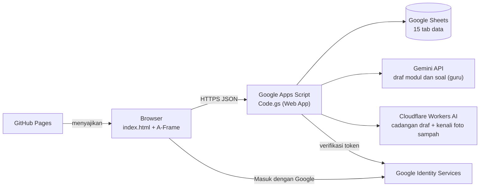

# Kelas Raudhah

**Kelas virtual 3D di browser untuk belajar Math, Science, Bahasa, Agama, dan Seni.** Dilengkapi penilaian otomatis, poin dan bintang, pemantauan guru, pembuat soal berbantuan AI, serta pencatatan **Adiwiyata**: lapor sampah, Kompos MBG, dan foto sampah yang dikenali AI.

> **RAUDHAH** = **R**uang **E**dukasi **d**an **D**igital **M**adrasah


-8ecae6)


**Demo:** https://diahayu88.github.io/kelas_raudhah/

---

## Daftar Isi

1. [Tentang](#tentang)
2. [Fitur](#fitur)
3. [Arsitektur](#arsitektur)
4. [Struktur Repositori](#struktur-repositori)
5. [Pemasangan](#pemasangan)
6. [Konfigurasi](#konfigurasi)
7. [Peran dan Hak Akses](#peran-dan-hak-akses)
8. [Keamanan](#keamanan)
9. [Privasi Data](#privasi-data)
10. [Alur Pembaruan](#alur-pembaruan)
11. [Pemecahan Masalah](#pemecahan-masalah)
12. [Peta Jalan](#peta-jalan)
13. [Kontribusi](#kontribusi)
14. [Lisensi](#lisensi)
15. [Kontak](#kontak)

---

## Tentang

**RAUDHAH** adalah akronim dari **Ruang Edukasi dan Digital Madrasah**: ruang belajar digital milik madrasah yang menyatukan materi, latihan, penilaian, pemantauan, dan kegiatan peduli lingkungan dalam satu tempat.

<!-- GAMBAR README 1: banner proyek (logo Kelas Raudhah + ruang kelas 3D), simpan di docs/banner.png lalu ganti baris ini dengan  -->

Kelas Raudhah memindahkan pengalaman duduk di kelas ke layar.
- **Siswa** berjalan di ruang kelas 3D, memilih meja mata pelajaran, membaca modul, mengerjakan 10 soal latihan, dan mengumpulkan poin.
- **Guru** membuat kelas, memantau progres, dan menyiapkan paket soal dengan bantuan AI. Paket itu selalu melalui persetujuan guru sebelum terlihat siswa.
- Lewat menu **Adiwiyata**, rombel mengumpulkan poin dari sampah yang dipilah dan dijadikan kompos.

Tujuan: meningkatkan motivasi belajar siswa MTs/SMP dengan media yang menarik, tanpa instalasi, tanpa biaya server, dan dengan data yang tetap berada di tangan pengelola.

Dikelola oleh pengelola Kelas Raudhah di MTsN 7 Kediri sebagai prototipe pembelajaran.

## Fitur

**Untuk siswa**
- Ruang kelas 3D dengan tujuh meja (Math, Science, Bahasa, Agama, Seni), dapat dibuka di ponsel (tegak dan mendatar) dan komputer.
- Kontrol: geser/WASD/joystick untuk berjalan dan melihat, klik meja untuk duduk, tombol Berdiri.
- Satu tombol **☰** membuka laci menu. Panel tampil sebagai lembar bawah di HP tegak atau lembar kanan di HP mendatar dan laptop. Gambar 3D dijeda saat panel terbuka supaya HP tidak berat.
- **Mode VR** satu layar dengan giroskop, dan berjalan dengan tatapan 1,5 detik.
- Kualitas grafis **Otomatis/Tinggi/Hemat**. Mode terang dan gelap otomatis.
- Masuk dengan akun Google, atau daftar dengan email dan sandi memakai kode kelas.
- Modul bacaan dan latihan 10 soal pilihan ganda yang tampil satu per satu, dengan penjelasan jawaban.
- Poin (10 per soal, hanya dari jawaban pertama) dan bintang (bawaan 100 poin = 1 bintang). Soal dan pilihan diacak per siswa.
- Aturan ketuntasan: selesaikan latihan yang sedang berjalan sebelum pindah mapel.

**Adiwiyata**
- **Papan rombel** bulanan: poin milik rombel, bukan pribadi.
- **Kader rombel** (maksimal 3) mencatat timbangan sampah.
- **Lapor sampah:**
  - botol plastik (buah) dan kertas (kg);
  - **Kompos MBG**: kulit buah dihitung berat standar × jumlah siswa; nasi, sayur, lauk, buah utuh, dan organik lain ditimbang (kg).
- Semua laporan **menunggu persetujuan** kader, guru, atau guru Adiwiyata sebelum menjadi poin.
- **Kalkulator takaran EM4:** bawaan 1 L larutan per 10 kg; tiap liter air + 10 ml EM4 + 10 ml molase. Dapat diatur pemilik.
- **Foto sampah dikenali AI** lewat Cloudflare Workers AI (Llama 3.2 Vision).
  - Foto dikecilkan ≤ 512 px dan **tidak disimpan**.
  - AI menyebut benda yang terlihat, siswa dapat mengoreksi, dan guru tetap menyetujui.
- Rekap CSV: rekap rombel, daftar laporan, dan rekap Kompos MBG per bulan.

**Untuk guru**
- Membuat kelas dan kode kelas; membuat akun siswa; memindahkan siswa antar-rombel.
- Memantau progres siswa pada kelas sendiri dan mengunduh rekap nilai.
- Pembuat paket soal dengan AI berstatus draf: modul 150–300 kata + soal LOTS/MOTS/HOTS. Memakai Gemini, dengan Cloudflare sebagai cadangan.
- Impor soal manual, sunting draf, setujui, tolak, dan tarik paket.
- Menunjuk kader dan meninjau laporan Adiwiyata rombelnya.

**Untuk pemilik (pengelola)**
- Menambah guru, menunjuk guru Adiwiyata, melihat semua kelas dan draf, dan mengatur batas harian pemakaian AI.
- Mengatur takaran kompos, berat standar kulit buah, jenis sampah, dan batas foto AI.
- Seluruh data terbuka di Google Sheets, termasuk log audit.

**Menu Juri:** akun demonstrasi tanpa sandi untuk penilai. Datanya direset dan tidak dapat mengubah data asli.

### Tampilan

Simpan gambar di folder `docs/`, lalu ganti setiap komentar dengan baris gambar. Tutup email, nama siswa, alamat `/exec`, dan Client ID pada tangkapan layar.

<!-- GAMBAR README 2: ruang kelas 3D tampak keseluruhan ->  -->
<!-- GAMBAR README 3: layar masuk dan pendaftaran ->  -->
<!-- GAMBAR README 4: modul dan soal satu per satu ->  -->
<!-- GAMBAR README 5: laci ☰ dan panel Adiwiyata di HP ->  -->
<!-- GAMBAR README 6: pembuat paket soal AI dan editor draf ->  -->

## Arsitektur



| Komponen | Teknologi | Peran |
|---|---|---|
| Antarmuka | HTML, JavaScript, A-Frame 1.5.0 (tertanam di `index.html`) | ruang 3D, laci menu, panel materi/soal/guru/Adiwiyata |
| Server | Google Apps Script (`Code.gs`) | login, hak akses, penilaian, progres, draf AI, Adiwiyata |
| Basis data | Google Sheets | pengguna, kelas, materi, soal, poin, Adiwiyata, log |
| Login | Google Identity Services | masuk dengan akun Google |
| AI teks | Gemini API, cadangan Cloudflare Workers AI (via server) | menyusun draf modul dan soal untuk guru |
| AI foto | Cloudflare Workers AI, Llama 3.2 Vision (via server) | menebak jenis sampah dari foto; Gemini tidak dipakai untuk foto |
| Hosting | GitHub Pages | menyajikan halaman statis |

**Data (15 tab):**
- **Belajar:** Pengaturan, Kelas, Pengguna, Mapel, Materi, Soal, Progres, Poin, Bintang, Log.
- **Adiwiyata:** Kader, Timbangan, Sampah, Laporan, JenisKompos.

## Struktur Repositori

```
kelas_raudhah/
├── index.html    # aplikasi: antarmuka 3D dan logika klien (A-Frame tertanam)
├── privasi.html  # kebijakan privasi
├── syarat.html   # ketentuan layanan
└── README.md     # dokumen ini
```

`Code.gs` dipasang di editor Apps Script yang terikat ke Google Sheets, bukan di repositori ini.

## Pemasangan

### Prasyarat

- Akun GitHub dan akun Google.
- Proyek di Google Cloud Console (untuk OAuth Client ID).
- Kunci API Gemini dari Google AI Studio (hanya untuk pembuat soal AI).
- Akun Cloudflare gratis: Account ID + token Workers AI (opsional, untuk foto sampah AI dan cadangan AI teks).

### 1. Repositori dan GitHub Pages

1. Buat repositori publik `kelas_raudhah`, unggah semua berkas ke cabang `main`.
2. Settings > Pages > Source: *Deploy from a branch* > `main` / `(root)`.
3. Alamat aplikasi: `https://<akun>.github.io/kelas_raudhah/`.

### 2. Google Sheets dan Apps Script

1. Buat Google Sheets baru, lalu Ekstensi > Apps Script.
2. Tempel isi `Code.gs`, simpan.
3. Isi Script Properties (lihat [Konfigurasi](#konfigurasi)).
4. Jalankan `siapkanSheet` sekali. Fungsi ini membuat tab belajar dan isi awal, dan aman diulang.
5. Jalankan `migrasiAdiwiyata` sekali. Fungsi ini membuat atau memperbarui tab Adiwiyata, dan aman diulang.
6. Jalankan `cekPemilik` untuk memastikan email pemilik terbaca.
7. Bila memakai foto AI: isi `CF_ACCOUNT_ID` dan `CF_API_TOKEN`, lalu jalankan `setujuiLisensiVisi` sekali untuk menyetujui lisensi Meta Llama 3.2.
8. Deploy > Deployment baru > Aplikasi Web > Jalankan sebagai: *Saya* > Akses: *Siapa saja*.
9. Salin alamat berakhiran `/exec`.

### 3. Login Google

1. Google Cloud Console > OAuth consent screen: isi nama aplikasi, tautan `privasi.html` dan `syarat.html`.
2. Credentials > OAuth client ID > *Web application*.
3. Authorized JavaScript origins: `https://<akun>.github.io`.
4. Salin Client ID.

### 4. Hubungkan halaman ke server

Pada awal skrip `index.html`, isi dua konstanta:

```js
var API_URL = 'https://script.google.com/macros/s/<ID-DEPLOYMENT>/exec';
var GOOGLE_CLIENT_ID = '<id-klien>.apps.googleusercontent.com';
```

Commit perubahan. Label versi di pojok kiri bawah halaman harus sama dengan versi server, misalnya `Kelas Raudhah v0.20.2 · server OK v0.20.2`. Bila tidak sama, label berubah merah.

### Daftar periksa

- [ ] GitHub Pages aktif
- [ ] `siapkanSheet` dan `migrasiAdiwiyata` sukses
- [ ] Client ID di halaman sama dengan di Script Properties
- [ ] Origin Google memuat alamat GitHub Pages
- [ ] `API_URL` berisi alamat `/exec` server **ASLI** (label tidak boleh berbunyi "MODE UJI")
- [ ] `VERSI` halaman sama dengan `VERSI` server

## Konfigurasi

### Script Properties (rahasia, tidak masuk Git)

| Kunci | Wajib | Keterangan |
|---|---|---|
| `GOOGLE_CLIENT_ID` | ya | Client ID OAuth Web |
| `PEMILIK_EMAIL` | ya | email pemilik, boleh beberapa, dipisah koma |
| `GEMINI_API_KEY` | untuk AI teks | kunci API Gemini |
| `GEMINI_MODEL` | tidak | mengganti model Gemini bawaan |
| `CF_ACCOUNT_ID`, `CF_API_TOKEN` | untuk foto AI / cadangan | Account ID dan token Workers AI Cloudflare |
| `CF_MODEL`, `CF_VISI_MODEL` | tidak | mengganti model teks / model foto Cloudflare |
| `AI_URUTAN` | tidak | urutan penyedia AI teks, misalnya `cloudflare,gemini1` |
| `JURI_MATI` | tidak | `ya` untuk mematikan Menu Juri |
| `JURI_BOLEH_SETUJUI` | tidak | `ya` bila juri boleh membagikan paket |
| `LINGKUNGAN` | hanya server uji | `uji` menandai server uji; label halaman menjadi "MODE UJI". **Jangan diisi di server asli.** |
| `SHEET_ID` | tidak | bila skrip tidak terikat langsung ke Sheets |

### Tab Pengaturan (dapat diubah tanpa menyunting kode)

| Kunci | Bawaan | Fungsi |
|---|---|---|
| `poin_per_bintang` | 100 | konversi poin ke bintang |
| `aturan_pindah_mapel` | `semua_soal_terjawab` | ubah ke `bebas` untuk mematikan aturan pindah mapel |
| `jatah_draf_per_hari` | 5 | batas draf AI per guru per hari |
| `jatah_draf_total_per_hari` | 15 | batas draf AI seluruh pengguna per hari |
| `guru_adiwiyata` | (kosong) | guru peninjau laporan semua rombel; diatur pemilik dari Panel Admin |
| `kompos_kg_per_takaran` | 10 | kg sampah per 1 takaran larutan |
| `kompos_larutan_ml` | 1000 | ml larutan per takaran |
| `kompos_em4_ml_per_l`, `kompos_molase_ml_per_l` | 10, 10 | ml EM4 dan molase per liter air |
| `kompos_foto_per_hari` | 150 | batas foto AI seluruh madrasah per hari (0 = fitur foto mati) |
| `kompos_foto_per_siswa` | 5 | batas foto AI per pengguna per hari |

Jenis sampah dan berat standar kulit buah diatur di tab **Sampah** dan **JenisKompos**, atau lewat Panel Admin.

### Peta mapel dan meja (tab Mapel)

| Mapel | Kode | Meja |
|---|---|---|
| Math | `MATH` | m1, m3 |
| Science | `SAINS` | m4, m6 |
| Bahasa | `BHS` | m2 |
| Agama | `AGAMA` | m5 |
| Seni | `SENI` | m7 |

## Peran dan Hak Akses

| Peran | Kemampuan |
|---|---|
| Siswa | belajar, menjawab, melihat progres dan poin sendiri, melapor sampah (menunggu persetujuan) |
| Kader rombel | siswa yang ditunjuk guru: mencatat timbangan dan meninjau laporan rombelnya (bukan laporan sendiri) |
| Guru | kelola kelas dan akun siswa, pantau kelas sendiri, buat dan setujui paket soal miliknya, tunjuk kader, tinjau laporan rombelnya |
| Guru Adiwiyata | guru yang ditunjuk pemilik: meninjau laporan semua rombel |
| Pemilik | semua kemampuan guru, tambah guru, lihat semua kelas dan draf, atur pengaturan dan Adiwiyata |

Peran pemilik hanya berlaku bila email ada di `PEMILIK_EMAIL`. Semua peran diperiksa di server.

## Keamanan

- Penilaian di server; kunci jawaban tidak pernah dikirim ke browser.
- Daftar putih aksi dan pemeriksaan peran pada setiap permintaan.
- Sandi disimpan sebagai hash SHA-256 bergaram (300 putaran). Lima kegagalan beruntun mengunci akun selama 10 menit.
- Token Google diverifikasi ke Google (audiens, email terverifikasi, kedaluwarsa).
- Sesi 6 jam; token disimpan di `sessionStorage`.
- Kunci API hanya di Script Properties dan dimasking pada log.
- Poin ganda dicegah dengan lock server, permintaan idempoten, dan aturan jawaban pertama.
- Teks masukan dibersihkan dari tag dan awalan rumus Sheets. Tanggal dan kode ditulis sebagai teks.
- Draf AI diperiksa otomatis dan tidak terlihat siswa sebelum disetujui guru.
- Foto sampah tidak disimpan, dan hanya dikirim ke Cloudflare (bukan Gemini). Ada batas harian foto, laporan, dan AI teks.

Menemukan celah keamanan? Mohon laporkan secara pribadi ke pengelola (lihat Kontak), jangan melalui isu publik.

## Privasi Data

**Data yang disimpan:**
- email dan nama akun Google; atau nama, asal sekolah, email, dan sandi (hash) untuk pendaftaran mandiri;
- aktivitas belajar: kelas, jawaban, poin, bintang;
- data Adiwiyata rombel: timbangan, laporan sampah, dan jenis sampah yang diduga AI (bukan fotonya).

Tidak ada akses ke Gmail, Drive, atau kontak. Data siswa tidak dikirim ke layanan AI. Data tidak dijual dan tidak dipakai untuk iklan, dan guru hanya melihat kelasnya.

Rincian: [Kebijakan Privasi](privasi.html) dan [Ketentuan Layanan](syarat.html).

## Alur Pembaruan

1. Ubah `Code.gs` dan `index.html`; naikkan `VERSI` di keduanya. Nama berkas rilis memuat versi.
2. Uji dulu di server dan halaman **uji** (Script Property `LINGKUNGAN=uji`, label "MODE UJI").
3. Cadangkan spreadsheet asli (File > Buat salinan) dan catat nomor versi deployment yang aktif.
4. Tempel `Code.gs` baru di Apps Script asli, simpan, lalu Deploy > Kelola deployment > Edit > *Versi baru* > Deploy. Alamat `/exec` tetap sama.
5. Bila versi itu membawa migrasi, jalankan `migrasiAdiwiyata` (aman diulang).
6. Commit `index.html` (dan `privasi.html`/`syarat.html` bila berubah) ke `main`.
7. Buka halaman dan pastikan label versi cocok, tanpa "MODE UJI".

**Kembali ke versi sebelumnya:**
1. Bila perlu, jalankan fungsi jalur kembali yang tertulis di panduan rilis, misalnya `kembalikanKeV017`.
2. Deploy > Kelola deployment > Edit > pilih nomor versi lama.
3. Commit ulang `index.html` lama.

## Pemecahan Masalah

| Gejala | Kemungkinan penyebab | Tindakan |
|---|---|---|
| Label versi merah | versi halaman dan server beda, atau server tidak menjawab | deploy ulang *Versi baru*; periksa `API_URL` |
| Label "server: belum diatur" | `API_URL` kosong | isi alamat `/exec` di `index.html` |
| Label "MODE UJI" di halaman asli | `API_URL` menunjuk server uji | ganti dengan alamat `/exec` server asli |
| Tombol Google tidak muncul atau gagal | origin belum terdaftar, atau Client ID tidak sama | periksa Authorized JavaScript origins dan `GOOGLE_CLIENT_ID` |
| Galat `GOOGLE_BELUM` | `GOOGLE_CLIENT_ID` belum diisi di server | isi Script Properties |
| Galat `AI_SETEL` | `GEMINI_API_KEY` belum dipasang | isi Script Properties |
| Galat `AI_KUOTA` (429) | kuota Gemini habis atau terlalu cepat | tunggu atau coba besok |
| Galat `AI_MODEL` (404) | model tidak tersedia | ubah `GEMINI_MODEL` |
| Galat `JATAH` | batas harian draf tercapai | tunggu besok atau ubah di tab Pengaturan |
| Tombol 📷 foto tidak muncul | `CF_ACCOUNT_ID`/`CF_API_TOKEN` belum diisi, atau `kompos_foto_per_hari` = 0 | isi Script Properties / ubah pengaturan |
| "Lisensi model foto belum disetujui" | lisensi Llama 3.2 belum diterima | jalankan `setujuiLisensiVisi` sekali |
| Tab tidak ditemukan / kolom belum diperbarui | `siapkanSheet` atau `migrasiAdiwiyata` belum dijalankan | jalankan sekali (aman diulang) |
| Perubahan kode tidak berlaku | deployment belum diperbarui | Deploy > Kelola deployment > Versi baru |

## Peta Jalan

- [x] Ruang kelas 3D dan lima mapel
- [x] Login Google dan akun sandi, peran pemilik/guru/siswa
- [x] Penilaian di server, poin, progres, aturan pindah mapel
- [x] Pengacakan soal dan pilihan per siswa
- [x] Pembuat draf AI, impor manual, sunting, setujui, tolak, tarik
- [x] Penukaran poin menjadi bintang dan Papan Bintang
- [x] Mode VR satu layar dan kualitas grafis Otomatis/Tinggi/Hemat
- [x] Laci menu ☰ dan panel lembar bawah/kanan
- [x] Adiwiyata: kader, timbangan, lapor botol/kertas, Kompos MBG, foto sampah AI, rekap CSV
- [ ] Eco-Gazebo 3D (ruang belajar terbuka dengan tong pilah yang bisa diketuk)
- [ ] Tampak depan dan peta sekolah (tampak atas)
- [ ] Uji beban kelas penuh
- [ ] Analisis butir soal untuk guru
- [ ] Bank soal bersama antarguru

## Kontribusi

Masukan dan saran sangat diterima melalui Issues. Untuk perubahan kode, buka Pull Request dengan deskripsi singkat dan langkah uji. Jaga agar versi halaman dan server tetap sama.

## Lisensi

[Tentukan lisensi, misalnya MIT atau CC BY-NC-SA 4.0, lalu tambahkan berkas `LICENSE`.]

Pustaka dan layanan pihak ketiga mengikuti lisensinya masing-masing: A-Frame (MIT); model foto Meta Llama 3.2 (Llama 3.2 Community License dan Acceptable Use Policy, diterima lewat `setujuiLisensiVisi`).

## Kontak

Pengelola Kelas Raudhah, MTsN 7 Kediri. Kontak resmi tercantum di halaman [Kebijakan Privasi](privasi.html).
